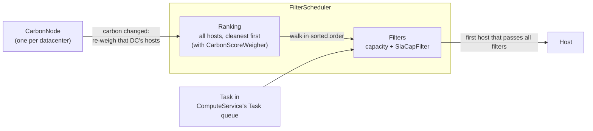

# Spatial Shifting in OpenDC Design

Problem we are solving: Carbon-aware placement of jobs onto hosts on different datacenters which at that point of time have lowest carbon-intense energy, while making sure we don't break any SLAs. In simple words, every task goes to the greenest host that meets the SLAs surrounding, region, cost and availability. We ideally won't these as per task, for simplicity of first implementation we do them as per-scenario. A task is also only placed once and never migrated again.

We are going to plug in the sla-capped filtering to hostfilter, and the carbon scoring to hostweighter which will be picked up by OpenDC's FilterScheduler.

CarbonNode gives us carbon intensity now and a forecast, and we want to consider forecast of upto 10 hours. We would need to implement, a CarbonRescorer, that essentially when a datacenter's carbon changes it calles updateIntensity.

## High-level design

- **Ranking**: This happens ahead of the time, and doesn't see the task at all just the hosts. They are ranked using the CarbonScoreWeigher, which sorts them based on the score they got on `w_now·carbon_now + w_fcst·carbon_forecast`, with the lowest first. When CarbonNode for that DC moves to a new value, `CarbonRescorer` asks for reweighing the hosts of that DC.
- **Placement**: This sees the tasks, on each scheduling, when `FilterScheduler.select()` is handed a task, it will walk the ranking in order, and the first host that passes the filters(including the SLA cap filter as well as capacity filters) is returned.
- **FUTURE EXTENSION:** The SLA cap fitler presently will compare DC's cost, availbility and region parameters, with the scenario's values, but this in the future should be per Task, and be compared against the Task's SLA requirements.

## Key points for claude code
- FilterScheduler only re-weighs on addHost and updateHost, which is why we need CarbonRescorer
- FilterScheduler ranks only one empty host based on modelId for hardware, we need to move to modelId,Datacentre, so within a datacentre samemodelid can have on rank
